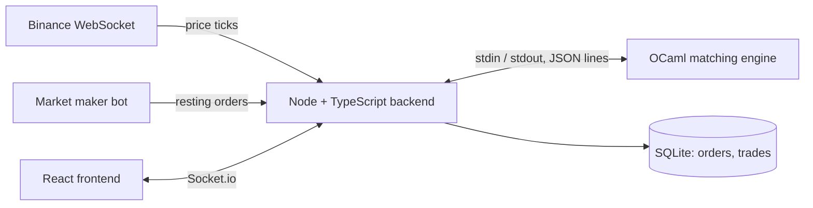

# Order Book Simulator

A live BTC/USDT trading dashboard built around a matching engine written from scratch in OCaml. The reference price comes from Binance, liquidity comes from a simulated market-maker bot, and every order is matched by a price-time priority engine.

**Live demo:** TODO (add Render / Vercel link)
**Screenshot / GIF:** TODO (add `docs/demo.gif`)

## What is real and what is simulated

| Part | Status |
|---|---|
| BTC/USDT reference price | **Real**, streamed from the Binance WebSocket |
| Bid/ask depth in the book | **Simulated**, posted by a market-maker bot (`bot_market_maker`) |
| Order matching and fills | **Real logic**, my own OCaml price-time priority engine |
| Money and balances | **None**, this is a simulator and nothing here trades real funds |

## Architecture



1. The backend receives Binance ticks and sends them to the engine.
2. Orders (from the frontend or the bot) pass validation and rate limiting, then go to the engine over stdin.
3. The engine matches them and prints JSON lines (`book` and `trades`) on stdout.
4. The backend stores trades in SQLite and broadcasts `book`, `fills` and `reset` events to all connected clients with Socket.io.

### Engine protocol (Node to OCaml, one command per line)

```
<symbol> <price> <size> <side> <timestamp>      # price tick
ORDER <userId> <side> <price> <size> <orderId>  # limit order
CANCEL <orderId>
RESET
```

The engine answers with one JSON object per line, for example `{"type":"book","data":{...}}` and `{"type":"trades","data":[...]}`.

## Features

**Matching engine (OCaml)**
- Price-time priority: best price first, then first-in-first-out within a price level
- Partial fills, order cancel and full book reset
- Each side of the book is an OCaml `Map` keyed by price, with a FIFO queue per price level
- `book.mli` exposes only the operations needed (`add_limit_order`, `cancel_order`, `apply_tick`, `get_snapshot`, `reset`), so the internal data structures stay private

**Backend (Node, TypeScript, Express, Socket.io)**
- OCaml engine runs as a child process, bridged over stdin/stdout
- Price validation (within ±20% of the reference price) and size validation (0.0001 to 2)
- Rate limiting: 5 orders per second per user (sliding window, in memory)
- SQLite persistence (`better-sqlite3`) for orders and trades
- Admin reset endpoint protected by a secret header

**Frontend (React, TypeScript, Vite)**
- Live order book with depth bars
- Price chart using TradingView `lightweight-charts`
- Recent fills panel and an order form with error banner

## Tech stack

| Layer | Tools |
|---|---|
| Engine | OCaml 5, dune |
| Backend | Node.js, TypeScript, Express, Socket.io, better-sqlite3 |
| Frontend | React, TypeScript, Vite, lightweight-charts |
| Deployment | Docker (multi-stage build), Render |

## Project structure

```
ocaml-engine/
  bin/main.ml          # stdin loop: reads commands, prints JSON snapshots
  lib/                 # book, level, matcher, types (+ .mli interfaces)
  test/
backend/src/
  server.ts            # Express + Socket.io entry point, admin routes
  db.ts                # SQLite schema
  engine/              # ocamlBridge.ts, marketMaker.ts, types.ts
  feeds/               # Binance client
  sockets/             # bookGateway.ts
frontend/src/
  components/          # OrderBookTable, OrderForm, PriceChart
  hooks/               # useOrderBookSocket.ts
Dockerfile
```

## Running locally

Requirements: Node.js, and OCaml with opam and dune.

```bash
# 1. Build the engine
cd ocaml-engine
dune build
cd ..

# 2. Backend (terminal 1)
cd backend
npm install
echo "ADMIN_SECRET=choose-a-long-random-string" > .env
npm run dev          # http://localhost:3001

# 3. Frontend (terminal 2)
cd frontend
npm install
npm run dev          # http://localhost:5173
```

### With Docker (backend and engine)

```bash
docker build -t orderbook .
docker run --rm -p 3001:3001 -e ADMIN_SECRET=choose-a-long-random-string orderbook
```

The Dockerfile has two stages: the first compiles the OCaml engine on Debian, the second is a slim Node image that copies in only the compiled `main.exe`.

### Environment variables

| Variable | Purpose |
|---|---|
| `ADMIN_SECRET` | Secret for the admin reset endpoint |
| `PORT` | Server port (default 3001) |
| `ENGINE_PATH` | Path to the compiled engine binary (set automatically in Docker) |

## API

**Admin reset** clears the engine book, the SQLite tables and the rate limiter, then notifies all clients.

```bash
curl -X POST http://localhost:3001/admin/reset -H "x-admin-secret: $ADMIN_SECRET"
# 200 {"ok":true}   401 {"error":"Unauthorized"} without the correct header
```

**Socket.io events** (server to client): `book` (depth snapshot), `fills` (new trades), `reset`.
Client to server: `subscribe` and `unsubscribe` with a symbol.

TODO: document the order placement endpoint/event.

## Design decisions

- **Engine as a separate process.** Keeping matching logic in its own OCaml program makes it testable without the web stack, and Node only does I/O.
- **Plain text over stdin/stdout.** Simple to debug (you can run the engine by hand), no RPC layer to maintain.
- **SQLite.** One file, no extra service. On free hosting the filesystem is ephemeral, so data resets on redeploy.
- **In-memory rate limiter.** Fine for one instance. With several servers it would need a shared store such as Redis.
- **No Redis, Kafka or JWT yet.** This is a single-instance simulator, so I kept the moving parts small and noted where they would be needed.

## Testing and performance

- Engine tests: TODO (partial fill, price-time priority, cancel, reset)
- Benchmark: TODO (orders per second, median and p99 latency, and how it was measured)

## Known limitations

- Depth is simulated, so fills do not reflect the real Binance order book.
- The market-maker bot adds new quotes without cancelling old ones, and does not prevent trading with itself.
- The admin endpoint uses one shared secret. There are no user accounts yet.
- CORS is currently open; restrict it to the frontend origin for production.
- Paper trading only.